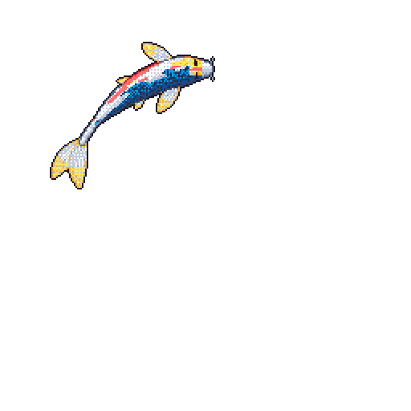

Final-year PhD candidate at the Archimedes Research Unit (Athena RC), supervised by Prof. Sotirios A. Tsaftaris (University of Edinburgh), Prof. Yannis Panagakis (NKUA), and Dr. Giorgos Papanastasiou (Academy of Athens).
My research focuses on causal machine learning and generative modeling, exploring how causal reasoning can make generative and representation learning models more robust, interpretable, and reliable.
I’m particularly interested in counterfactual generation and learning under latent confounding, with applications in medical imaging and computer vision.
